<div align="center">
  
  &nbsp;&nbsp;
  
  &nbsp;&nbsp;
  

  <h2>Arkaizn's Dotfiles</h2>

  <p>niri + Quickshell on Arch Linux, with a pywal theme that follows the wallpaper.<br>
  Includes an installer that turns a fresh Arch install into this setup.</p>
</div>

## Screenshots

<table>
  <tr>
    <td align="center"><a href="images/01-desktop.png"></a><br><sub><b>Desktop</b>: bar, fastfetch, btop</sub></td>
    <td align="center"><a href="images/02-launcher.png"></a><br><sub><b>Launcher</b>: frecency-ranked apps, Tab for clipboard / wallpapers</sub></td>
    <td align="center"><a href="images/03-wallpapers.png"></a><br><sub><b>Wallpapers</b>: picking one re-themes everything</sub></td>
  </tr>
  <tr>
    <td align="center"><a href="images/04-dashboard.png"></a><br><sub><b>Dashboard</b>: profile, music, calendar, system stats</sub></td>
    <td align="center"><a href="images/05-controlcenter.png"></a><br><sub><b>Control center</b>: power, Wi-Fi, BT, tools, mixer</sub></td>
    <td align="center"><a href="images/06-traymenu.png"></a><br><sub><b>Tray menu</b>: themed menus from the bar</sub></td>
  </tr>
  <tr>
    <td align="center"><a href="images/07-notification.png"></a><br><sub><b>Notifications</b>: popups top right</sub></td>
    <td align="center"><a href="images/08-lockscreen.png"></a><br><sub><b>Lockscreen</b>: clock, media, notifications</sub></td>
    <td align="center"><a href="images/09-lockscreen-auth.png"></a><br><sub><b>Unlock</b>: password or YubiKey</sub></td>
  </tr>
</table>

## Installation

Start from a fresh Arch Linux install:

```sh
git clone https://gitlab.silnas.ch/arkaizn/Dotfiles && cd Dotfiles
./install.sh        # packages, configs, themes
./postinstall.sh    # optional: apps, zsh, nvidia, openrgb, greetd
```

## Timeline

Each version is a git tag. Expand a version to see its screenshots.

| Version | Date | Setup |
|---|---|---|
| **current** | 2026-06 → | niri + Quickshell (screenshots above) |
| [`v0.3`](../../tree/v0.3) | 2026-04 | Hyprland + Quickshell redesign |
| [`v0.2`](../../tree/v0.2) | 2025-11 | Hyprland + early Quickshell |
| [`v0.1`](../../tree/v0.1) | 2025-09 | Hyprland + Waybar + swaync |
| [`v0.0`](../../tree/v0.0) | 2024-10 | Gnome |

<details>
<summary><b>v0.3</b>: Hyprland + Quickshell redesign</summary>
<br>
<table>
  <tr>
    <td><a href="images/history/v0.3-hyprland-quickshell/fastfetch-eva.png">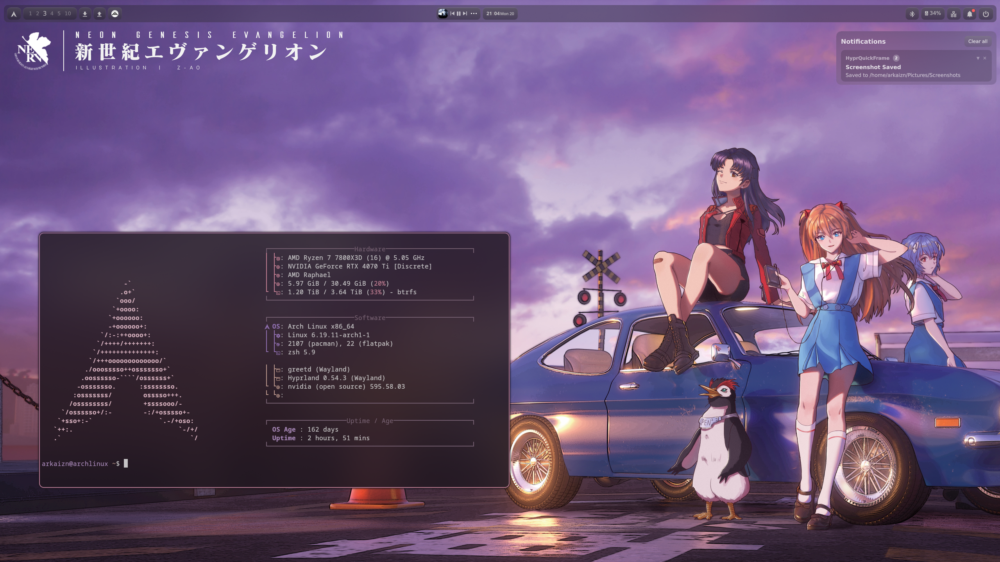</a></td>
    <td><a href="images/history/v0.3-hyprland-quickshell/browser-purple.png">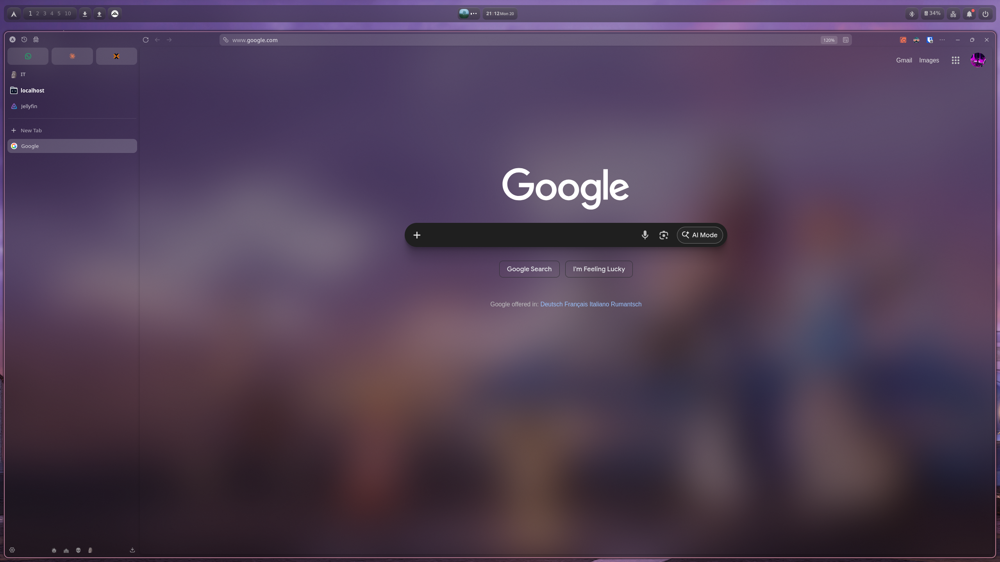</a></td>
    <td><a href="images/history/v0.3-hyprland-quickshell/fastfetch-fuji.png">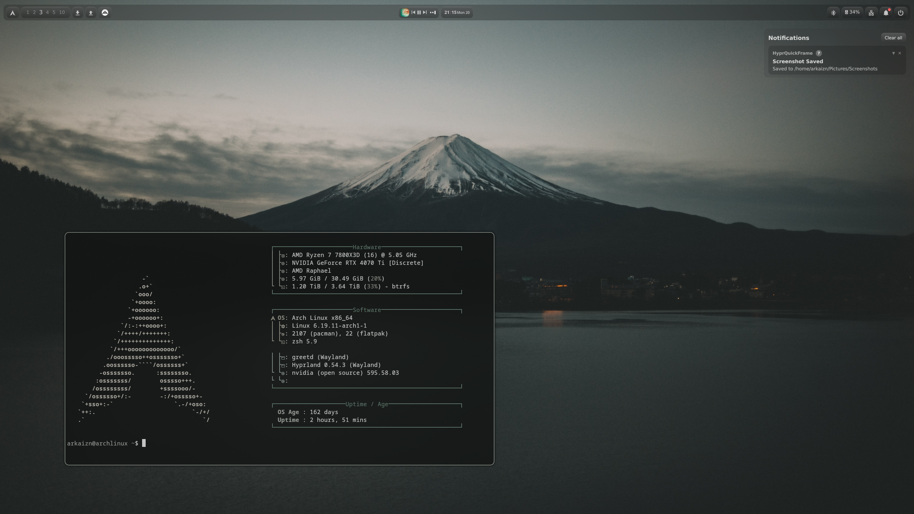</a></td>
  </tr>
  <tr>
    <td><a href="images/history/v0.3-hyprland-quickshell/browser-dark.png">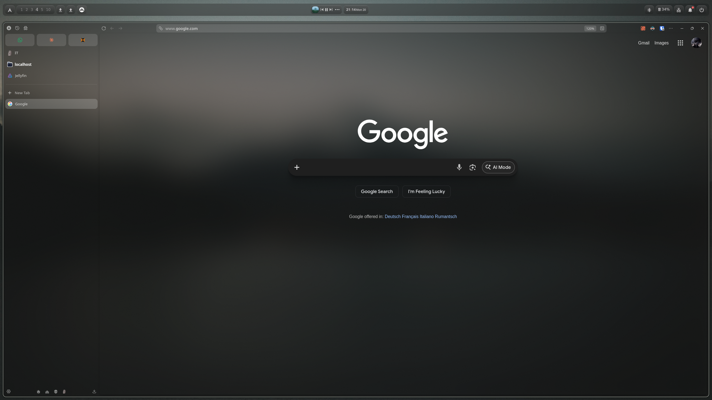</a></td>
    <td><a href="images/history/v0.3-hyprland-quickshell/notifications-space.png">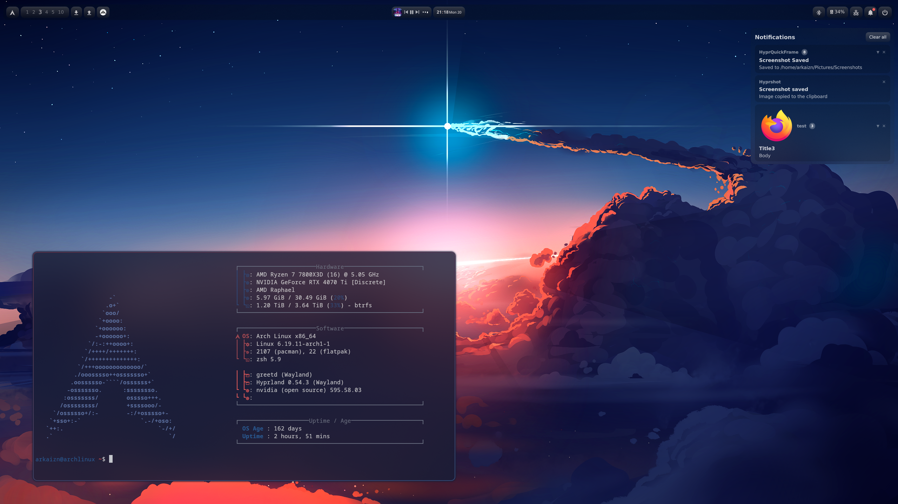</a></td>
    <td><a href="images/history/v0.3-hyprland-quickshell/browser-blue.png">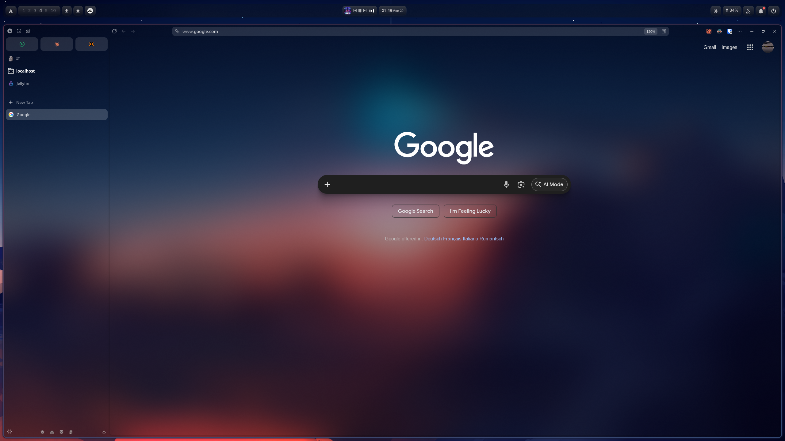</a></td>
  </tr>
</table>
</details>

<details>
<summary><b>v0.2</b>: Hyprland + early Quickshell (no screenshots)</summary>
</details>

<details>
<summary><b>v0.1</b>: Hyprland + Waybar + swaync</summary>
<br>
<table>
  <tr>
    <td><a href="images/history/v0.1-hyprland-waybar/fastfetch-kaneki.png">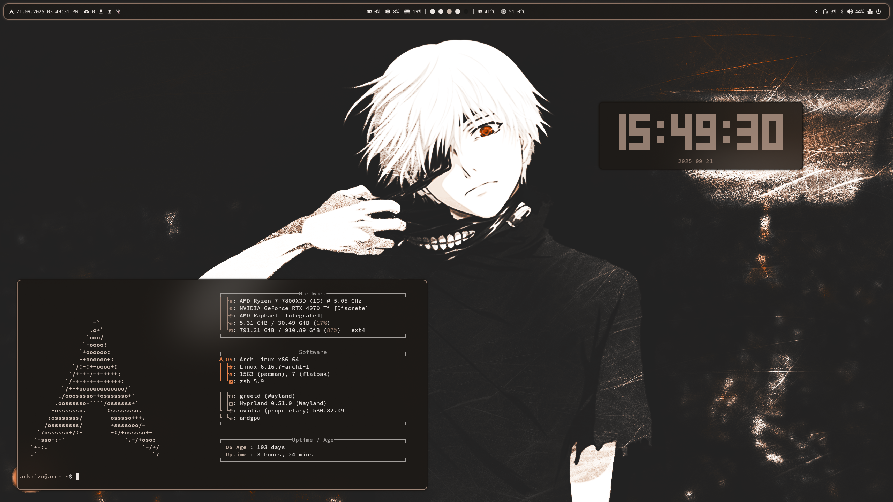</a></td>
    <td><a href="images/history/v0.1-hyprland-waybar/browser-brown.png">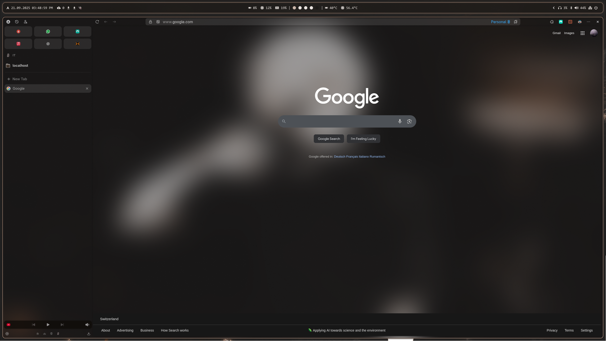</a></td>
    <td><a href="images/history/v0.1-hyprland-waybar/swaync-brown.png">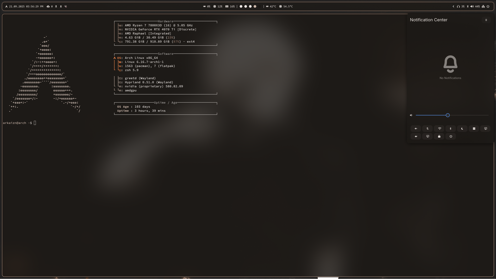</a></td>
  </tr>
  <tr>
    <td><a href="images/history/v0.1-hyprland-waybar/fastfetch-eva.png">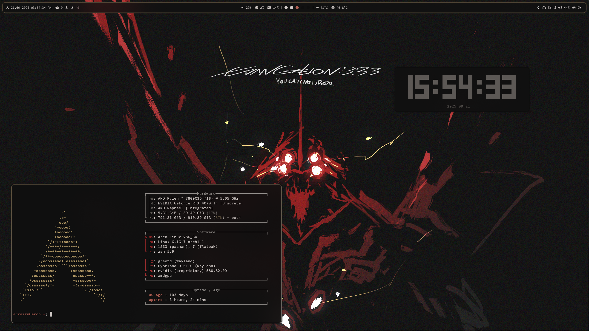</a></td>
    <td><a href="images/history/v0.1-hyprland-waybar/browser-red.png">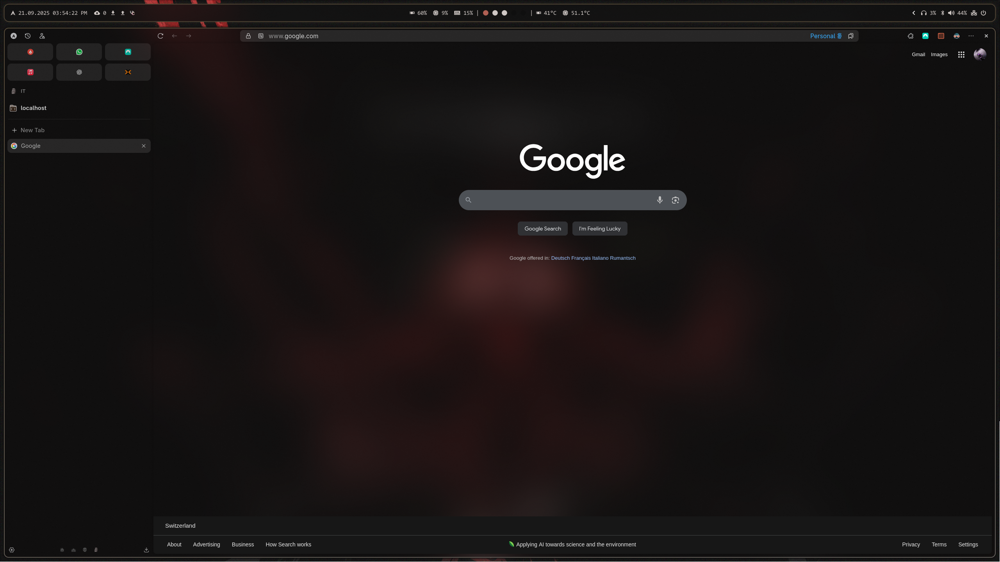</a></td>
    <td><a href="images/history/v0.1-hyprland-waybar/swaync-red.png">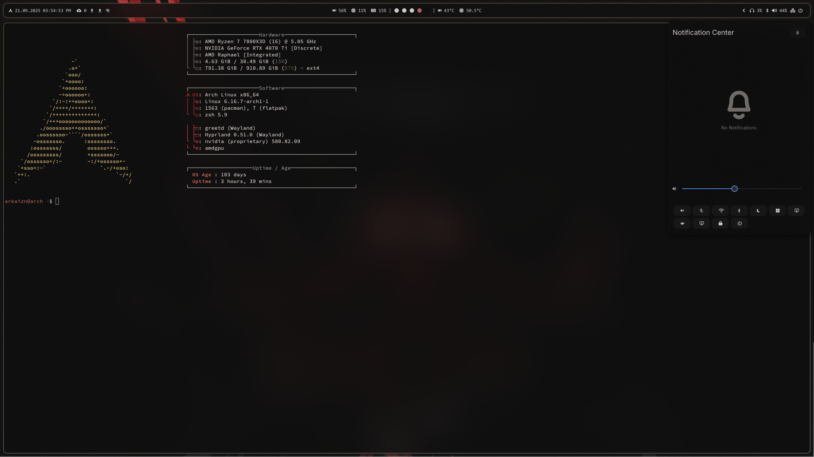</a></td>
  </tr>
</table>
</details>

<details>
<summary><b>v0.0</b>: Gnome (no screenshots)</summary>
</details>

## License

GPL-3.0. See [LICENSE](LICENSE).
